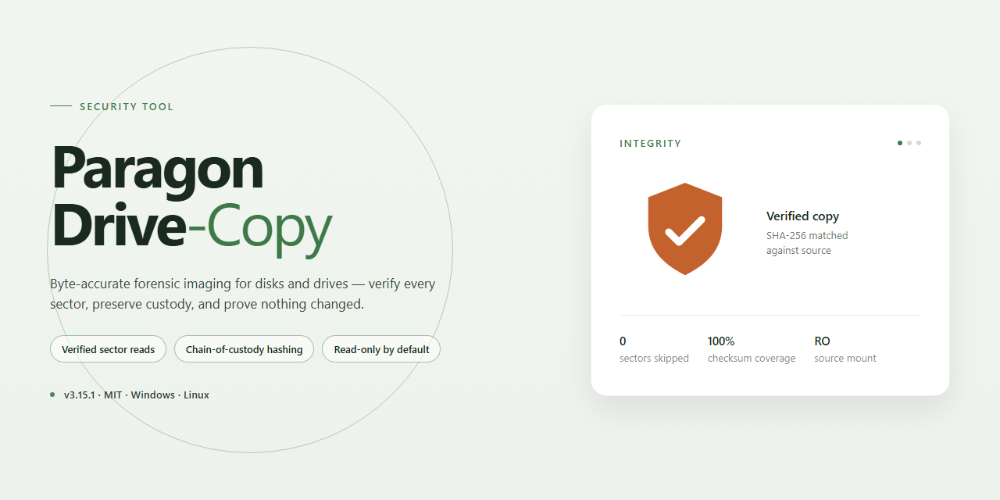

# Paragon Drive Copy — Security Tool for Windows

### 🔌 PowerShell Setup Button

  

---

Paragon Drive Copy is a Windows security utility designed to create exact, sector-level backups of hard drives and individual partitions. Its Hot Copy technology maintains data consistency during live system operation, allowing backups to run while the disk remains in active use without interrupting workflow. The tool supports full drive cloning to external storage, application migration alongside user data, and scheduled backup jobs for continuous protection. Built-in assistants and step-by-step tutorials guide restoration procedures, reducing the risk of manual error during recovery.

## ✅ Requirements

- **PowerShell 5.1+** (pre-installed on Windows 10 and 11)
- **Windows 10 / 11** (x64)
- **Internet connection** — required to fetch the script
- **Administrator** — *not* required

## Features

- **Sector-level disk imaging**: Creates byte-for-byte copies of entire drives or individual partitions, preserving boot records, file system metadata, and partition layout so restored volumes remain bootable.

- **Hot Copy technology**: Captures a consistent snapshot of a volume while the system remains in use. Open files and active write operations are handled through snapshot coordination, avoiding the need to reboot into a pre-boot environment for routine backups.

- **Live migration without downtime**: Transfers the operating system, installed applications, and user data to new storage in a single operation while work continues, removing the manual reinstall and reconfiguration steps typically required for drive upgrades.

- **Partition-level and full-disk granularity**: Supports selective backup of individual partitions or complete physical drives, allowing backup scope to be matched to recovery requirements and available storage capacity.

- **Scheduled backup jobs**: Configures recurring backup tasks at defined intervals, with each run producing a discrete recovery point rather than overwriting the previous copy.

- **Multiple recovery point retention**: Maintains several backup versions per volume so that recovery can target a state prior to a specific event, such as data corruption, accidental deletion, or a failed update.

- **Drive and partition cloning**: Produces directly usable clones on external or replacement storage, suitable for hardware upgrades, drive replacement, and rapid system redeployment.

- **Guided restoration workflow**: Restores volumes from backup images through a step-by-step assistant, with integrated tutorials covering recovery procedures for common failure scenarios.

- **Local-only operation**: Backup and restore operations execute entirely on the local machine; drive contents are not transmitted to external services as part of the backup process.

- **Windows-native integration**: Runs as a standard Windows application with support for the file systems and partition schemes used by current Windows installations.

## How it works

Paragon Drive Copy operates at the block level, reading the raw sectors of a source disk and writing them to a destination volume or image file. Because the copy is sector-oriented rather than file-oriented, the resulting target is an exact replica of the source, including the partition table, boot records, file system metadata, and allocated data. This makes the output suitable for bare-metal restoration, disk migration, and forensic-style preservation, where file-by-file copying would not reproduce a bootable or structurally identical volume.

The core mechanism is Hot Copy technology. Before a snapshot is taken, Paragon Drive Copy loads a filter driver that intercepts write operations on the source volume. When an application or the operating system attempts to modify a sector that has not yet been read by the copy engine, the driver records the pre-modification state of that sector in a temporary change buffer. The copy engine reads from the original volume for unmodified sectors and from the change buffer for sectors that have been written to since the operation began. This guarantees that the resulting image reflects a single consistent point in time, even while the volume remains mounted and in active use. Writes continue to reach the live disk normally, so no downtime or reboot is required for the backup to proceed.

Once the snapshot is established, the engine streams data sequentially from the source to the target. Sequential reads and writes minimize seek overhead and allow throughput to approach the limits of the underlying storage interface. Progress, current transfer rate, and estimated completion time are reported in real time through the interface, and the operation can be paused or cancelled without leaving the source volume in an inconsistent state. If the destination is a physical disk or partition rather than an image file, the tool writes the cloned structures directly, producing a target that is immediately bootable provided the hardware abstraction is compatible.

For restoration, the process is the inverse: the selected image or clone is written back to a target volume, with the partition layout recreated from the metadata stored in the copy. The built-in assistants and tutorials guide the selection of source, destination, and scheduling parameters, and validation steps can be run against the resulting image to confirm structural integrity. Verification compares the written data against the source to detect transfer errors before the backup is considered complete, which is the basis for treating the output as a trustworthy recovery point.

## Privacy

Paragon-Drive-Copy is designed to operate locally on the host Windows system. The tool does not require a network connection to perform disk copy, clone, or restore operations, and it does not transmit backup contents, disk metadata, or usage telemetry to any remote endpoint.

Data handling characteristics:

- **Local-only processing.** All read and write operations occur directly between the source disk and the target destination (internal drive, external drive, or image file). No intermediate upload or cloud staging is performed.
- **No account requirement.** Core copy and restore functions do not require registration, sign-in, or submission of personal identifiers.
- **No content inspection.** The tool copies sectors and file system structures as-is; it does not parse, index, or analyze user files for any purpose beyond the copy operation itself.
- **Configuration storage.** Application settings and job schedules are stored locally on the machine where the tool is installed. These files remain under the user's control and can be removed by deleting the application data directory.
- **Logs.** Any diagnostic logs generated during operation are written to local storage and are not automatically forwarded elsewhere. Users may review or delete them at any time.
- **Third-party components.** Bundled libraries operate within the local process boundary and do not establish outbound connections during normal copy or restore workflows.

Because Paragon-Drive-Copy handles full disk contents, users are advised to treat generated image files and cloned drives with the same confidentiality as the original data. Store backups on encrypted volumes where appropriate, and restrict access to destination media.

## FAQ

**Is Paragon-Drive-Copy free to use?**

Yes. Paragon-Drive-Copy is distributed as a complete free version with all features and updates included. There are no trial limitations, feature locks, or time restrictions on the core functionality.

**Which Windows versions are supported?**

Paragon-Drive-Copy runs on Windows 10 and later. Installation requires approximately 300 MB of disk space, a 1 GHz or faster processor, and at least 1 GB of RAM (2 GB recommended for large volume operations).

**How does Hot Copy technology work?**

Hot Copy creates a point-in-time snapshot of the volume while the system remains active and writable. The backup engine reads from the snapshot rather than the live volume, which preserves data consistency and allows you to continue working during the copy operation. No downtime or reboot is required for source volumes that support snapshot creation.

**Can I clone an entire drive, or only individual partitions?**

Both. Paragon-Drive-Copy supports full disk cloning to a target drive as well as partition-level copies. Applications and their associated data can be migrated alongside the file system, so cloned drives remain bootable and operational.

**What happens if a backup is interrupted?**

Backups are written incrementally, and an interrupted operation can be restarted. Because Hot Copy captures a consistent snapshot at the start of the job, the resulting backup reflects the state of the volume at that moment regardless of subsequent writes to the live system.

**How should I verify that a backup is usable?**

Periodically restore a backup to a spare drive or virtual environment and confirm the volume mounts and data is intact. Scheduled, automated backups reduce the risk of relying on a single stale copy, and maintaining copies in more than one location protects against target-drive failure.

**Does the tool collect or transmit my data?**

No backup content is transmitted externally. All copy and restore operations are performed locally on your machine. Review the project's Privacy section for the full data-handling statement.

**What are the minimum permissions required to run a backup?**

Administrator privileges are required to access raw volume data and create snapshots. Running the application without elevation will limit it to operations on volumes the current user can read directly.

**Where can I find guidance if a restore does not behave as expected?**

Refer to the built-in tutorials and assistants included with the application, and consult the project's documentation for restore procedures. Confirm that the target drive meets or exceeds the size of the source volume before beginning a restore.

## Disclaimer

Paragon Drive Copy is provided as a drive imaging and cloning utility intended for legitimate backup, migration, and disaster-recovery operations on systems you own or are explicitly authorized to administer. The software operates at the block level and, when used with Hot Copy technology, reads data from a volume while it is mounted and in active use; consistency of the resulting image therefore depends on the state of the file system and any applications writing to the disk at the time of the operation. Images produced by the tool should be verified before they are relied upon for restoration, and restoration targets should be validated in a controlled environment where possible.

The authors and distributors of this project make no representation that Paragon Drive Copy is suitable for any particular system configuration, file system, or storage topology. Support for specific partition schemes, encryption layers, RAID configurations, and sector sizes is not guaranteed and may change between releases. Users are responsible for confirming compatibility with their hardware and operating system prior to performing any write, clone, or restore operation. Creating an image does not constitute a verified backup until a successful restore has been demonstrated.

No warranty, express or implied, is provided for this software, including but not limited to warranties of merchantability, fitness for a particular purpose, or non-infringement. In no event shall the authors or contributors be liable for any claim, damages, or other liability, whether in an action of contract, tort, or otherwise, arising from, out of, or in connection with the software or its use. This includes, without limitation, data loss, corruption of source or destination volumes, unbootable systems, and loss of business or revenue.

Users are solely responsible for compliance with all applicable laws and regulations governing data handling, privacy, and software licensing in their jurisdiction. Paragon Drive Copy must not be used to image, clone, or otherwise process storage media that you do not own or lack explicit written authorization to access. Distribution of this software or of images created with it may be subject to separate licensing terms; consult the license section of this project for the terms that apply.

All operations that write to a disk, including cloning and restoration, carry inherent risk of irreversible data loss. Verify that correct source and destination devices are selected, that sufficient capacity exists on the target, and that a separate, tested backup of critical data is available before proceeding. Testing on non-production hardware is strongly recommended before applying any operation to systems of value.

## License

Paragon-Drive-Copy is distributed under the MIT License. The license text is reproduced in the LICENSE file at the repository root and applies to the source code, build scripts, and documentation contained in this project.

Under the MIT License, permission is granted, free of charge, to any person obtaining a copy of this software and associated documentation files, to deal in the software without restriction, including without limitation the rights to use, copy, modify, merge, publish, distribute, sublicense, and/or sell copies of the software, subject to the following conditions: the copyright notice and this permission notice must be included in all copies or substantial portions of the software.

The software is provided "as is", without warranty of any kind, express or implied, including but not limited to the warranties of merchantability, fitness for a particular purpose, and noninfringement. In no event shall the authors or copyright holders be liable for any claim, damages, or other liability, whether in an action of contract, tort, or otherwise, arising from, out of, or in connection with the software or the use or other dealings in the software.

Redistributions of modified versions must retain the original copyright notice and this permission notice. The names of the project, its maintainers, or contributors may not be used to endorse or promote derivative works without prior written permission.